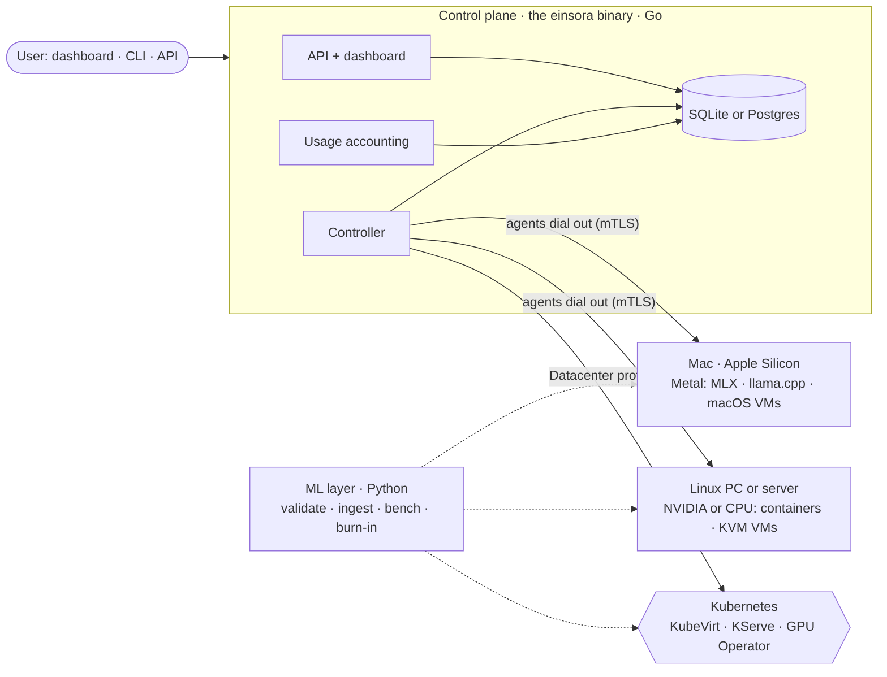

# Einsora

**A free, open GPU cloud you run yourself.** Install it on any machine you have, from a MacBook or
Mac Studio to a gaming PC or a rack of NVIDIA servers. Then launch **GPU VMs**, **Jupyter notebooks**,
and **OpenAI-compatible model endpoints** on it. Use it alone, share it with your team or class, or lend
idle machines to others. The same software runs from one laptop to a datacenter, **free for everyone**:
students, developers, startups, small companies, enterprises, and big tech.

> **Website: [einsora.com](https://einsora.com)**, with every document
> below, searchable. See the [product definition](docs/product/product-spec.md) for the full picture.

## What you can run

| Workload | Mac (Apple Silicon) | Linux + NVIDIA | CPU-only machine |
|---|---|---|---|
| **GPU VM**: a full VM with root access over SSH | macOS VM with Metal | KVM with whole-GPU passthrough | Linux VM |
| **Notebook**: JupyterLab with a persistent workspace | PyTorch (MPS) and MLX on Metal | PyTorch with CUDA | PyTorch on CPU |
| **Model endpoint**: an OpenAI-compatible API | MLX or llama.cpp on Metal | vLLM or llama.cpp | llama.cpp (small models) |

If the GPU you want is busy, opt-in fallbacks run your workload on another GPU, on CPU, or on another machine.

**Nothing is hidden.** Every workload keeps a detailed timeline of what happened and why. You can read it in
the CLI or dashboard and download a complete copy. Only secrets are redacted, and the export lists each one
([logs and transparency](docs/architecture/logs-and-transparency.md)).

## Three ways to deploy, one product

| Profile | For | Install |
|---|---|---|
| **Solo** | One person, one machine | One binary: `einsora up` (built from source today; packages planned) |
| **Lab** | Classes, teams, home labs, small companies, with mixed Mac and Linux machines | `einsora up` on one machine and `einsora agent` on the rest (planned) |
| **Datacenter** | Startups at scale, enterprises, big tech | Kubernetes with KubeVirt, KServe, and the GPU Operator ([deploy/](deploy/), [infra/](infra/)) |

Every machine is **private by default**. Owners can share an idle machine with invited people, or with a
community pool, under strong host protections ([ADR-0014](docs/adr/0014-sharing-idle-compute.md)).

## Architecture at a glance



Details are in [docs/architecture/overview.md](docs/architecture/overview.md).

## Repository layout

```
controlplane/   Go: the einsora binary — API, controller, usage accounting, (planned) node agent, dashboard host
ml/             Python: model validation, ingestion, endpoint benchmarks, GPU burn-in
web/            TypeScript: the dashboard
deploy/         Datacenter profile: helmfile for cluster add-ons, cluster-config chart, einsora chart
infra/          Datacenter profile: Ansible bootstrap for Linux GPU servers
images/         Launch catalog and notebook/VM image definitions
docs/           Product spec, architecture, ADRs, roadmap, runbooks, playbooks, hardware
```

## Run it on your machine

Prerequisites: Go 1.27+, [uv](https://docs.astral.sh/uv/), and Node 22+. On a Mac: `brew install go uv node`.

```bash
make build                      # the einsora binary, with its dashboard built in
controlplane/bin/einsora up     # asks for your owner account, then opens the dashboard
```

It keeps everything in one private directory (macOS: `~/Library/Application Support/Einsora`; Linux:
`~/.local/share/einsora`) and listens on `127.0.0.1` only. Notebooks and model endpoints run on your Mac's
GPU (Metal) or, on Linux, in Docker with NVIDIA. See the [quickstart](docs/runbooks/00-quickstart.md).

## Develop it (no GPU needed; runs on macOS and Linux)

```bash
make doctor     # checks the prerequisites and tells you what to install
make setup      # install dev dependencies for all components
make dev        # API, controller, and usage accounting in one process, with an in-memory store and a fake backend
make web-dev    # dashboard on http://localhost:5173 (in a second terminal)
```

```bash
curl -s localhost:8080/v1/catalog -H 'X-Dev-Tenant: acme' | jq
curl -s localhost:8080/v1/workloads -H 'X-Dev-Tenant: acme' -H 'Content-Type: application/json' \
  -d '{"name":"llm","kind":"endpoint","image_id":"openai-endpoint","gpu_class":"l40s-48gb","gpu_count":1,
       "model_uri":"hf://Qwen/Qwen2.5-0.5B-Instruct"}' | jq
curl -s localhost:8080/v1/workloads -H 'X-Dev-Tenant: acme' | jq   # pending → provisioning → running
```

The same binary is a CLI client. In a third terminal:

```bash
cd controlplane && go build -o bin/einsora ./cmd/einsora
export EINSORA_DEV_TENANT=acme              # dev mode; EINSORA_API_URL defaults to http://127.0.0.1:8080
bin/einsora workloads                      # your workloads (-all includes deleted ones)
bin/einsora events <id>                    # full timeline: every state change and note, when, why, and by whom
bin/einsora export <id>                    # download everything recorded about it to a JSON file
```

For full server logs, run `make dev EINSORA_LOG_LEVEL=debug EINSORA_LOG_FILE=$PWD/einsora.log`.

Real owner workloads are available through the in-process agent: JupyterLab (Apple GPU or explicit CPU) and MLX on Apple Silicon,
and JupyterLab (CPU or NVIDIA) and vLLM (NVIDIA) through a local Linux Docker Engine. See the
[local setup instructions](docs/runbooks/00-quickstart.md#run-real-workloads-on-linux). Linux/CUDA
hardware validation is pending.

`make build-all` cross-compiles the binary for macOS (Apple Silicon), Linux amd64, and Linux arm64.

## Status

| | Built | Planned |
|---|---|---|
| Control plane | API, lifecycle, quotas, controller, usage accounting, SQLite, Postgres, and in-memory stores, Kubernetes backend, regions, machines, and placement in the data model, timeline and log export, CLI client, local accounts, `einsora up` (Solo, with the dashboard built in), in-process agent, Mac native and Linux Docker drivers | Networked agents, VM drivers, packages and installers, choosing a region, fallback placement, sharing, workload output logs, activity log |
| ML layer | Model validator (safetensors), ingestion, benchmarking, CUDA burn-in | GGUF validation, Metal burn-in |
| Dashboard | Workload list, launch form, workload timeline and full-log download | Machines, sharing, usage reports, embedded in the binary |
| Datacenter | Charts, add-ons, Ansible, runbooks (rendered and linted, not yet run on hardware) | Production validation |

The full plan is in the [roadmap](docs/roadmap.md). Your Mac is enough hardware for Phases 1–2.

## Docs

All of these are also on the [website](https://einsora.com), built from this repository
by `site/` (`make site-dev` to preview it).

- [Product definition](docs/product/product-spec.md)
- [Roadmap](docs/roadmap.md)
- [Architecture](docs/architecture/overview.md)
- [Decisions (ADRs)](docs/adr/README.md)
- [Runbooks](docs/runbooks/README.md)
- [Playbooks](docs/playbooks/)
- [Glossary](docs/glossary.md)

## Working with AI agents

- [AGENTS.md](AGENTS.md) holds the canonical instructions for Codex and other agents.
- [CLAUDE.md](CLAUDE.md) imports AGENTS.md and adds Claude Code skills and subagents.
- Each component directory has its own `AGENTS.md` and `CLAUDE.md`.

## Licence

[MIT](LICENSE): anyone may use, change, and redistribute Einsora, including commercially. It's free for
everyone, with no paid tier ([ADR-0011](docs/adr/0011-free-for-everyone.md),
[ADR-0020](docs/adr/0020-name-and-licence.md)). Models keep their own licences.
